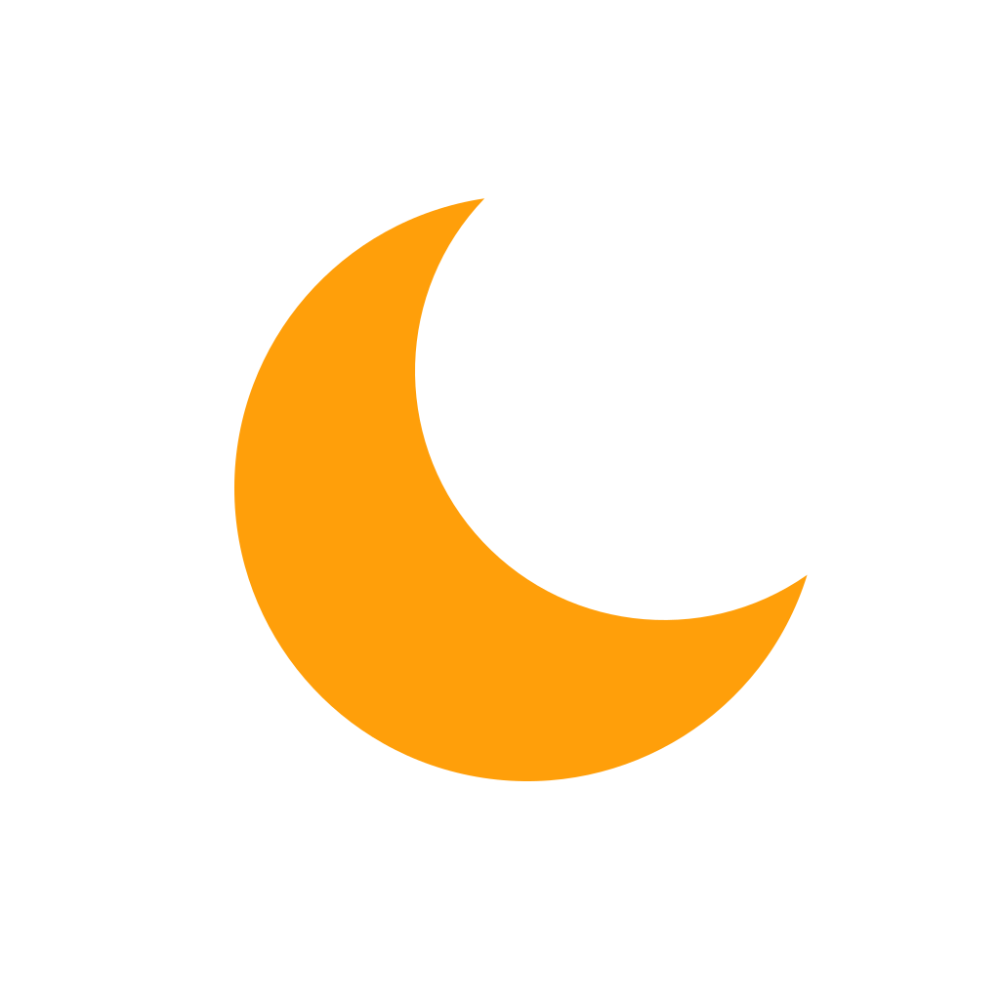

<div align="center">



# NeoSound

**为 iPhone 打造的原生 ASMR.ONE 第三方收听客户端**

SwiftUI · 连续播放 · 离线下载 · 字幕随行


[](LICENSE)

[功能](#功能) · [构建安装](#构建安装) · [使用说明](Docs/FEATURES.md) · [免责声明](DISCLAIMER.md)

</div>

> [!IMPORTANT]
> NeoSound 是独立开发的非官方客户端，与 ASMR.ONE、DLsite 及内容创作者不存在隶属、授权或背书关系。本项目不提供音声内容或内容授权。请仅访问、缓存和下载你有权使用的作品，使用前阅读[免责声明](DISCLAIMER.md)。

## 关于 NeoSound

用原生 iOS 交互浏览作品、管理收听列表，并在在线播放与离线收听之间切换。账号、作品目录及媒体服务由第三方提供；服务端变化可能影响可用性。

## 功能

### 发现作品

- 双列作品网格、排序筛选、搜索和标签浏览，支持下拉刷新及自动翻页。
- 登录后查看个性化推荐，未登录时浏览热门作品。
- 默认过滤成人内容；成人内容开关需年龄确认，过滤结果仍依赖服务端标注。
- 可选日语标题翻译，使用用户自己的 DeepSeek API Key。

### 专注收听

- 全屏封面、字幕与播放队列，迷你播放器随标签栏收起。
- 提前准备下一首，支持连续衔接、随机、循环、倍速及睡眠定时。
- 自动匹配字幕，无有效字幕时隐藏字幕按钮。
- 无缝体验取决于音频格式和缓冲状态；文件自带静音不会被自动删除。

### 下载与缓存

- 播放、收藏、下载并列；仅下载当前选中的完整版本，不提供单曲下载入口。
- 下载页显示实时速度、百分比和已下载／总字节数，支持暂停、继续、重试及删除。
- 优先复用完整原始音频缓存；清理缓存不会删除正式下载。
- 完整版本下载后封面显示角标，本地音频、封面及匹配字幕可离线使用。
- 后台下载受 iOS 调度限制；未完成文件重试时重新下载，不提供分段续传保证。

### 按你的习惯使用

- 本地作品收藏、跨作品音轨列表、资料库导入与导出。
- 可选择启动标签页，拖动调整浏览、推荐、列表顺序；搜索固定在末尾。
- 浅色／深色外观、缓存容量和 API 线路设置。

更多说明见[功能与使用说明](Docs/FEATURES.md)。

## 构建安装

需要 **Xcode 27、iOS 27+、Swift 6 和 XcodeGen**。目前可从源码构建，仓库不包含开发者签名证书。

```sh
git clone https://github.com/Fab1e2000/NeoSound.git
cd NeoSound
xcodegen generate
open NeoSound.xcodeproj
```

在 Xcode 的 Signing & Capabilities 中选择你自己的 Team，连接 iPhone 后运行。`project.yml` 中的 Team 标识需按自己的账号修改；重新生成工程会覆盖工程文件中的设置。

模拟器测试（设备名称按本机调整）：

```sh
xcodebuild -project NeoSound.xcodeproj -scheme NeoSound \
  -destination 'platform=iOS Simulator,name=iPhone 18 Pro' \
  -derivedDataPath build/DerivedData test CODE_SIGNING_ALLOWED=NO
```

## 隐私与数据

登录令牌与翻译 Key 保存在本机钥匙串。账号请求发送至所选 ASMR.ONE API；启用翻译后，标题会发送给 DeepSeek。音频和封面从服务端提供的地址加载，第三方可能记录网络请求。

资料库备份可选择包含登录信息和 API Key，请勿公开备份文件。下载音频不包含在资料库 JSON 备份中。卸载前请自行保存需要的文件。

## 反馈

欢迎通过 [Issues](https://github.com/Fab1e2000/NeoSound/issues) 提交问题，请附 iOS 版本、复现步骤及已脱敏的日志。不要上传登录令牌、密码、API Key、私人备份或无权分发的作品文件。

## 致谢与许可

播放器移植自 [NeoDizzy](https://github.com/Fab1e2000/NeoDizzy)，并包含源自 [MeloX](https://github.com/youshen2/MeloX) 的代码。README 排版参考 [NeoBili](https://github.com/Fab1e2000/NeoBili)。

本项目以 [GNU GPL v3.0](LICENSE) 发布。第三方来源见 [THIRD_PARTY_NOTICES.md](THIRD_PARTY_NOTICES.md)，接口与验证边界见 [集成文档](Docs/ASMR-INTEGRATION.md)。软件许可证不授予任何第三方音频、图片、字幕或商标的使用权。
